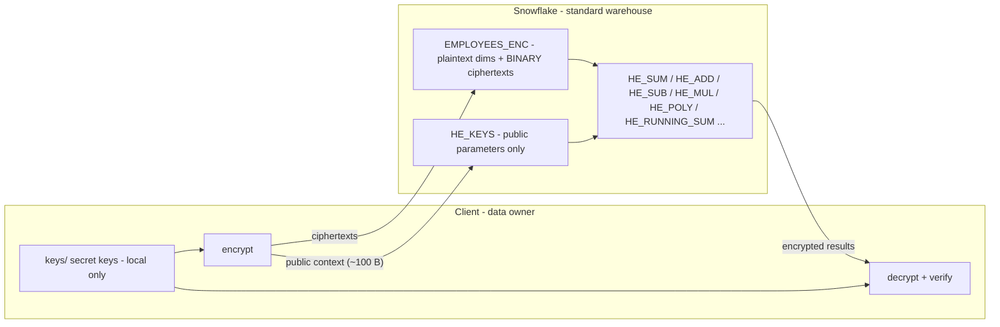

# Homomorphic encryption on Snowflake with Pyfhel

Compute on **encrypted columns inside Snowflake** (sums, averages, net pay, statistics, conditional sums,
ML scoring, running totals) while **Snowflake never sees a single plaintext value and holds no secret key**.

* Keys are generated and kept on the client; only ciphertexts and public parameters are uploaded.
* The homomorphic operations are ordinary **Python UDFs / UDAFs / UDTFs in a standard warehouse**, using
  Snowflake's Anaconda `pyfhel` package. No Snowpark Container Services, external functions or extra
  infrastructure.
* Results come back encrypted and are decrypted on the client. All 185 results in the notebooks are
  verified against plaintext ground truth.

> **Demo, not a product.** This is an independent technical demonstration. It is not an official Snowflake
> feature, it has not been security-reviewed for production use, and it is not production-grade cryptographic
> engineering. See [SECURITY.md](SECURITY.md) for the threat model.



## What you can compute

Every row below is a working query in the notebooks. Snowflake evaluates it on ciphertexts; the client decrypts.

| Category | Calculation | How (SQL sketch) | Scheme | Notebook |
|---|---|---|---|---|
| Aggregates | SUM, COUNT, AVG over a full encrypted column | `HE_SUM(ctx, salary_ct)`, `COUNT(*)`; avg = Σ / n after decryption | BFV | 01 §3 |
| | GROUP BY, GROUP BY ROLLUP, WHERE on plaintext dims | regular SQL around `HE_SUM` | BFV | 01 §4–5 |
| | Share of total | ratio of two decrypted sums | BFV | 01 §4 |
| Encrypted ± encrypted | gross pay, **net pay = salary + bonus − deductions** | `HE_SUB(ctx, HE_ADD(ctx, s, b), d)` | BFV | 01 §6 |
| Constant arithmetic | flat deduction, negation, 3% raise + $1,000, employer cost `1.08·s + b + 1,200` | `HE_ADD_PLAIN`, `HE_NEG`, `HE_MUL_PLAIN` | BFV | 01 §7 |
| Weighted average | FTE-weighted salary with plaintext weights | `HE_SUM(HE_MUL_PLAIN(ctx, s, fte_pct)) / SUM(fte_pct)` | BFV | 01 §8 |
| Decimals | average rate, +5% uplift, **currency conversion** via plaintext FX join | `HE_MUL_PLAIN(ctx, rate_ct, fx.usd_to_local)` | CKKS | 01 §9 |
| Encrypted × encrypted | labor cost = rate × hours, SUMPRODUCT | `HE_SUM(HE_MUL(ctx, rate_ct, hours_ct))` | CKKS | 02 §1 |
| | hours-weighted average rate (encrypted numerator *and* denominator) | Σ(rate·hours) / Σ hours | CKKS | 02 §1 |
| Statistics | mean, variance (pop/sample), std dev, covariance, **Pearson correlation**, **regression slope/intercept** | encrypted Σx, Σx², Σy, Σy², Σxy via `HE_SQUARE`/`HE_MUL` | CKKS | 02 §2 |
| Encrypted conditions | **COUNTIF / SUMIF** where the 0/1 condition itself is encrypted; `1 − flag` | `HE_MUL(ctx, HE_MUL(ctx, rate, hours), remote_flag_ct)` | CKKS | 02 §3 |
| ML scoring | linear model on encrypted features; top-k ranking client-side | `HE_ADD_PLAIN(HE_ADD(HE_MUL_PLAIN(x1,w1), …), b)` | CKKS | 02 §4 |
| | logistic risk via degree-3 sigmoid approximation | `HE_POLY(ctx, perf_ct, [c0,c1,c2,c3])` | CKKS | 02 §4 |
| Time series | running total (YTD), month-over-month delta, 3-month moving sum | `HE_RUNNING_SUM` UDTF `OVER (PARTITION BY … ORDER BY …)`; `HE_SUB(ct, LAG(ct))` | BFV | 02 §5 |
| Packed / SIMD | whole column in **one** ciphertext; SUM/AVG via rotations | `HE_PACKED_SUM(ctx, rot_keys, ct, n)` | BFV | 03 §2 |
| | elementwise raise / add on all rows at once | `HE_MUL_PLAIN`, `HE_ADD` on packed ciphertexts | BFV | 03 §3 |
| | dot product with a plaintext vector (FTE-weighted rate) | `HE_PACKED_DOT(ctx, rot_keys, ct, ARRAY_AGG(w))` | CKKS | 03 §4 |
| | elementwise encrypted × encrypted | `HE_MUL` on packed ciphertexts | CKKS | 03 §5 |

**Not possible** with these schemes: comparisons on encrypted values (`WHERE salary > x`, `ORDER BY`,
`MIN/MAX`, `DISTINCT`, joins on encrypted keys) and division by an encrypted value. Keep filter and grouping
columns plaintext (or tokenized), and divide after decryption.

## Quickstart

Prerequisites:

* [pixi](https://pixi.sh). It provides Python, the compilers and CMake, so no system toolchain is needed.
* Network access to github.com for the first build (SEAL fetches Zstandard and GSL).
* A Snowflake role that can create a database (or owns the target one) and use a warehouse. Anaconda
  packages must be usable in the account; they are by default.

```bash
git clone https://github.com/sfc-gh-kkeller/snowflake-homomorphic-encryption.git
cd snowflake-homomorphic-encryption

pixi install            # builds the vendored Pyfhel 3.4.2 + SEAL 4.1.2 (first time: a few minutes)
pixi run test           # 21 offline tests: every UDF handler, locally, with public-context-only Pyfhel

cp config.example.toml config.toml   # set connection_name / role / warehouse
pixi run deploy         # database, schema, tables, 13 homomorphic functions
pixi run load           # keygen (first run), encrypt locally, upload ciphertexts + public parameters
pixi run demo           # build notebooks from notebooks/*.py and execute them in place
pixi run lab            # ... or explore interactively in JupyterLab
```

`pixi run test-snowflake` runs integration tests in a separate `<schema>_TEST` schema (dropped afterwards).
`pixi run clean-snowflake` drops the demo database after a typed confirmation.

Configuration lives in `config.toml` (gitignored); every value can also be set via `HE_*` environment
variables, see [config.example.toml](config.example.toml). The connection is resolved from
`~/.snowflake/connections.toml`.

## Snowflake objects

Functions (all take the public `ctx BINARY` first, so one set of functions serves every key and both schemes):

| Function | Kind | Returns |
|---|---|---|
| `HE_SUM(ctx, ct)` | aggregate (UDAF) | Σ ct |
| `HE_ADD(ctx, a, b)`, `HE_SUB(ctx, a, b)`, `HE_NEG(ctx, a)` | scalar | a + b, a − b, −a |
| `HE_ADD_PLAIN(ctx, a, k)`, `HE_MUL_PLAIN(ctx, a, k)` | scalar | a + k, a · k (k plaintext) |
| `HE_MUL(ctx, a, b)`, `HE_SQUARE(ctx, a)` | scalar | a · b, a² (both encrypted) |
| `HE_POLY(ctx, a, [c0..c3])` | scalar | c0 + c1·a + c2·a² + c3·a³ |
| `HE_INFO(ctx, a)` | scalar | what the server can see: size, polynomials, level, scale |
| `HE_RUNNING_SUM(ctx, ct, row_key)` | table function (UDTF) | running Σ within `PARTITION BY … ORDER BY` |
| `HE_PACKED_SUM(ctx, rot_keys, ct, n)` | scalar | Σ of the first n slots (lands in slot 2^⌈log₂n⌉ − 1) |
| `HE_PACKED_DOT(ctx, rot_keys, ct, weights)` | scalar | Σ wᵢ·xᵢ (CKKS) |

Tables: `HE_KEYS` (public parameters, plus public rotation keys for packed keys), `EMPLOYEES_ENC`,
`REVENUE_MONTHLY_ENC`, `PACKED_COLUMNS`, `FX_RATES`. See [sql/10_tables.sql](sql/10_tables.sql).

## Parameters, precision and limits

| Key | Parameters | Ciphertext | Precision / range | Depth |
|---|---|---|---|---|
| BFV (row) | n=4096, t≈2^34, q=[36,36,37] | ~86 KB | **exact**; results must stay within ±t/2 ≈ ±8.6·10⁹ or they wrap (01 §10) | adds + plaintext multiplies; **no ct × ct** |
| CKKS (row) | n=8192, scale 2^35, q=[60,35,35,60] | ~300 KB | ~1e-8 relative at depth 0–1, ~1e-5 at depth 2; depth-2 results within ±1.6·10⁷ | **2 multiplications** |
| BFV / CKKS packed | same | one ciphertext per column (4,096 slots) | as above | rotations need public Galois keys (1.9 MB / 9.2 MB) |

Measured with 100 employees (100 rows × 8 encrypted columns ≈ 182 MB of ciphertext) on an X-Small warehouse:
local encryption ~3 s, upload ~2 min, typical encrypted query 2–13 s. In packed mode the salary column shrinks
from 8.9 MB (100 ciphertexts) to 88 KB (one ciphertext).

Design notes:

* **No evaluation keys in row mode.** Products are left un-relinearized (3- or 4-polynomial ciphertexts),
  which SEAL can still add, rescale and decrypt. Snowflake therefore receives nothing but the ~100-byte public
  context (no public key, no relinearization key), so it can neither decrypt nor encrypt.
* **Exact CKKS scale management.** Pyfhel loses a ciphertext's modulus level on deserialization; the
  handlers recover it from the serialized size, encode plaintext constants at the ciphertext's exact scale,
  and align polynomial terms to identical scales instead of rounding them.
* **UDAF semantics.** `HE_SUM` keeps one running ciphertext per worker (`accumulate`), ships it as bytes
  (`aggregate_state`), and combines partial sums (`merge`). Homomorphic addition is associative, so any
  partitioning gives the same result (tested with random partitions in `tests/test_handlers.py`).
* **Single source of truth.** [src/he_snowflake/udf_handlers.py](src/he_snowflake/udf_handlers.py) is
  embedded verbatim as the handler of every Snowflake function *and* imported by the offline tests.

## Repository layout

```
src/he_snowflake/   config, keys (client), crypto (client), data (synthetic), udf_handlers (server),
                    deploy, load, verify
sql/                table DDL
notebooks/          01_basics, 02_advanced, 03_packed_simd. *.py (jupytext) are the sources, *.ipynb carry outputs
tests/              offline handler tests + opt-in Snowflake integration tests
vendor/             patched Pyfhel 3.4.2 with SEAL 4.1.2 (see vendor/PATCHES.md)
scripts/            refresh_vendor.sh (reproduce vendor/), scan_secrets.sh, show_outputs.py
```

## Why a vendored Pyfhel?

PyPI only ships Pyfhel 3.4.2 as source, and that source bundles Microsoft SEAL 4.0. Snowflake's Anaconda build
of `pyfhel 3.4.2` links **SEAL 4.1**, and SEAL refuses to deserialize objects from a different minor version
(`RuntimeError: incompatible version`). The vendored copy swaps in SEAL 4.1.2 so local ciphertexts load in
Snowflake, and disables SEAL's bundled zlib, which does not compile on recent macOS SDKs.
[vendor/PATCHES.md](vendor/PATCHES.md) documents both changes; `scripts/refresh_vendor.sh` reproduces the
tree from upstream with checksum verification.

## Troubleshooting

| Symptom | Cause / fix |
|---|---|
| `numpy.dtype size changed ... Expected 96 from C header, got 88` in a UDF | numpy 2.x resolved; pin `numpy==1.26.4` next to `pyfhel==3.4.2` (deploy does) |
| `RuntimeError: incompatible version` in a UDF | ciphertexts built with SEAL 4.0 (PyPI Pyfhel); use this repo's pixi env |
| `symbol not found ... seal13parms_id_zero` on import | SEAL failed to build silently; check that `vendor/` has `SEAL_USE_ZLIB = 'OFF'` and run `pixi reinstall Pyfhel` |
| Python process aborts (`libc++abi: terminating`) | some SEAL errors are fatal C++ exceptions, e.g. decrypting without keys or rotating a 3-polynomial ciphertext. Handlers validate inputs to avoid them |
| `Expression type does not match column data type ... BINARY ... VARIANT` | `write_pandas` uploads `bytes` as VARIANT; `load.py` uploads base64 and converts with `TO_BINARY` |
| BFV result is wildly wrong | exceeded ±t/2 and wrapped; rescale units (e.g. dollars instead of cents) or use CKKS |
| `Unknown function HE_SUM` | session has no current schema; qualify as `HE_DEMO.PYFHEL.HE_SUM` |

## License

Apache License 2.0, see [LICENSE](LICENSE) and [NOTICE](NOTICE). The vendored Pyfhel is Apache-2.0 and
Microsoft SEAL is MIT; see [vendor/PATCHES.md](vendor/PATCHES.md).
